<div align="center">

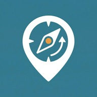

# Rumbo 🧭

**Connecting World Cup 2026 visitors with Mexico City's small local businesses.**

*Build a walking route around what you feel like doing, see every business with prices in your currency, and translate any paper menu with your phone's camera. No download needed.*

<a href="https://rumbo-orpin.vercel.app"></a>

[](https://nextjs.org)
[](https://www.typescriptlang.org)
[](https://supabase.com)
[](https://www.mapbox.com)
[](https://ai.google.dev)
[](https://web.dev/progressive-web-apps/)
[](#-team)

<br>

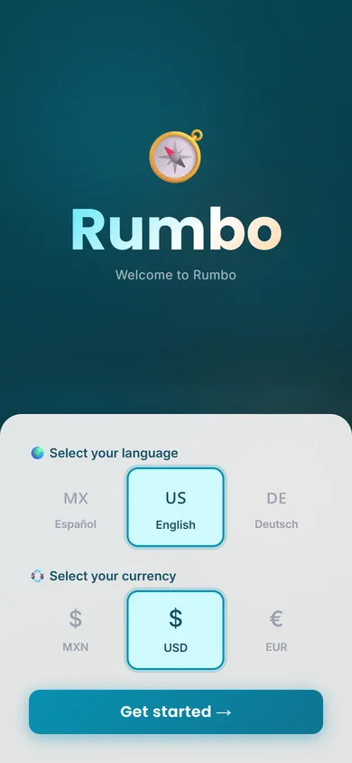&nbsp;
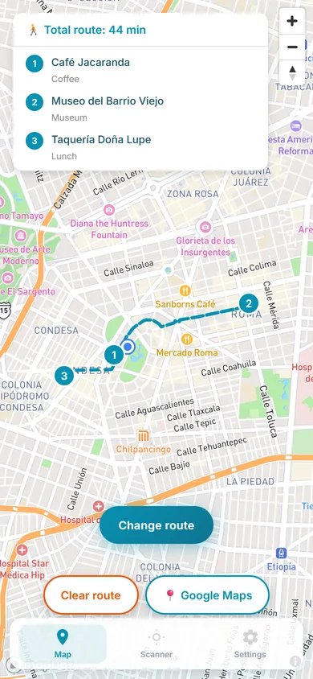&nbsp;
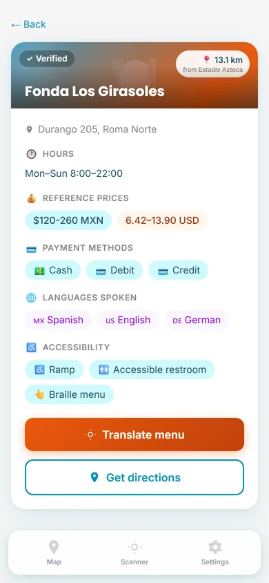&nbsp;
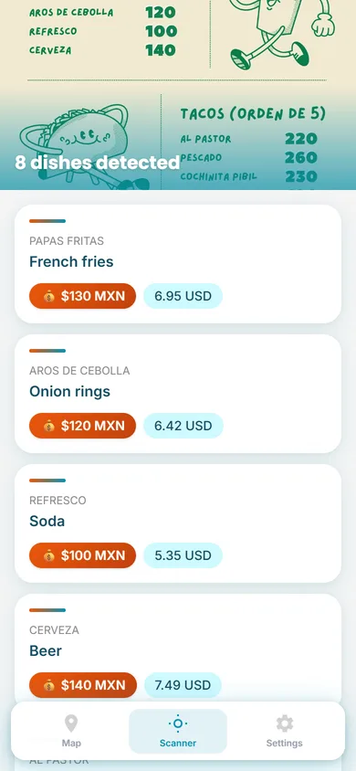

</div>

---

## What is Rumbo?

During the **FIFA World Cup 2026**, Mexico City will receive hundreds of thousands of visitors. Most
of them will end up in the same handful of chains and tourist spots, while the small fondas, cafés,
markets and galleries next door stay invisible, partly because of the language barrier and partly
because nobody knows they exist.

**Rumbo** is a PWA built for the **Fundación Coppel** track at **Talent Land 2026**: *"A fair pitch
in the World Cup for local tourism businesses"*. It works straight from the browser:

- 🗺️ **Tourists** pick how many places they want to visit and what they feel like (breakfast, a
  museum, a market…), choose between nearby local options and get a **walking route** on the map.
- 💱 Every business shows its price range **converted to the visitor's currency**, the languages it
  speaks, how to pay and its accessibility.
- 📷 At the table, the **menu scanner** reads a photo of a paper menu and translates every dish, with
  the price in the visitor's currency.
- 🏪 **Business owners** register their place for free and an **administrator** reviews it before it is
  published.

The app is available in **English, Spanish and German**, with prices in **MXN, USD or EUR**.

> **Note:** the demo runs on Supabase's free tier, which pauses inactive projects. The screenshots
> show fictional businesses in Condesa and Roma; the map, the walking route and the menu translation
> are real.

---

## 📸 Screenshots

### Planning a route

<div align="center">

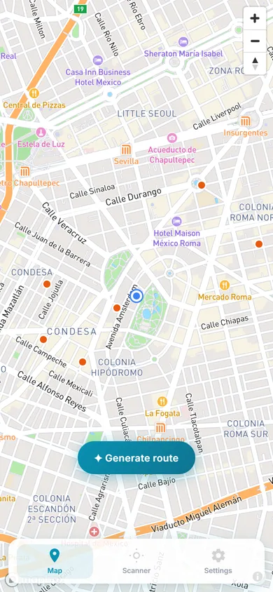&nbsp;
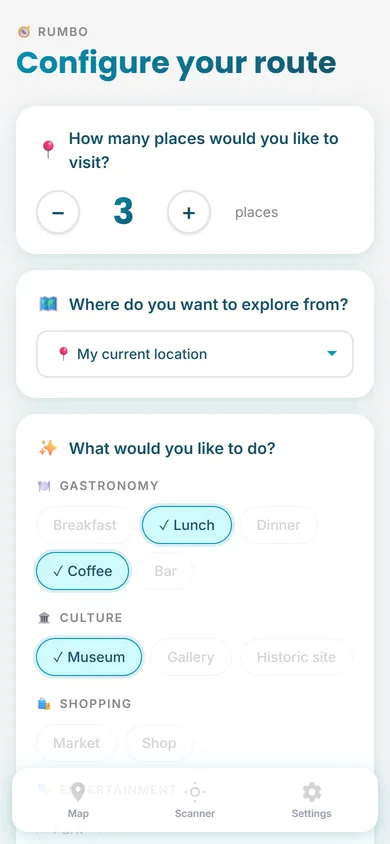&nbsp;
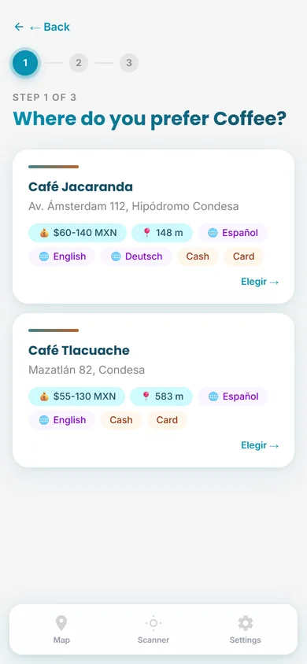&nbsp;


</div>

### Businesses and menus

<div align="center">

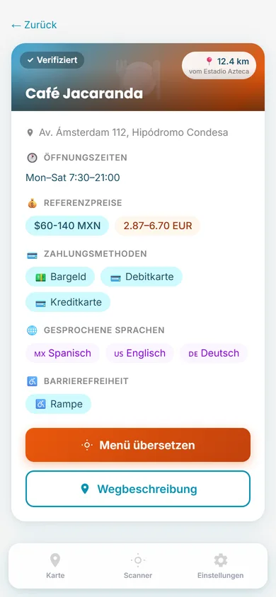&nbsp;
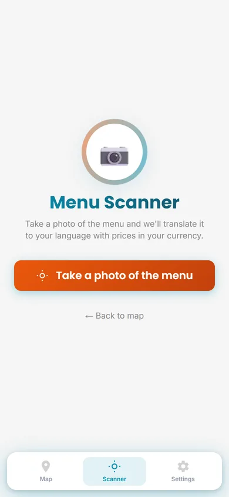&nbsp;


</div>

### Settings and business owners

<div align="center">

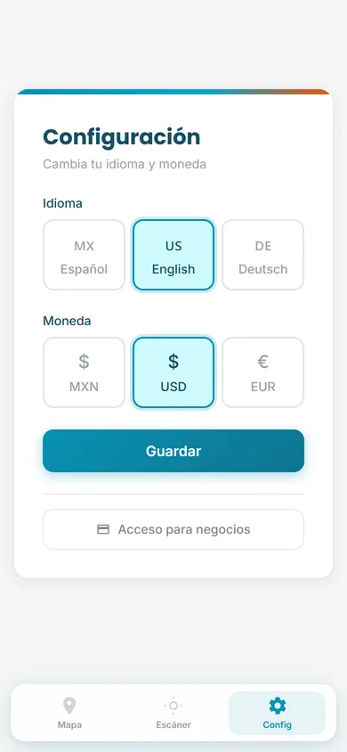&nbsp;
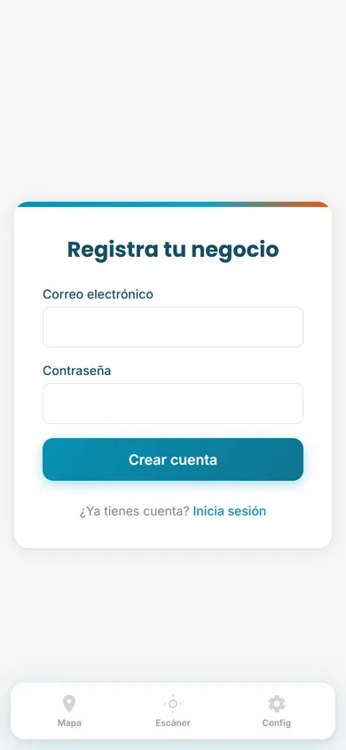

</div>

---

## ✨ Features

### For visitors
- 🌐 **Onboarding in one screen**: language (English, Español, Deutsch) and currency (MXN, USD, EUR),
  changeable at any time from Settings.
- 🗺️ **Interactive map** (Mapbox) with your location and every approved business; tap a pin for a
  quick preview.
- 🧭 **Personalized routes**:
  1. Choose how many places to visit (2 to 6) and where to start: your **GPS location** or a zone
     (Condesa / Roma, Centro Histórico, Coyoacán, Polanco).
  2. Pick one category per stop: gastronomy (breakfast, lunch, dinner, coffee, bar), culture
     (museum, gallery, historic site), shopping (market, shop) or entertainment (park).
  3. For each stop, choose between the **closest options** (computed with PostGIS), each with price,
     distance, languages and payment methods.
  4. Get the **walking route** drawn on the map with the **Mapbox Directions API**, the total time and
     a shortcut to open it in Google Maps.
- 🏷️ **Business details**: address, hours, reference prices **converted to your currency**
  (Frankfurter API), payment methods, languages spoken, accessibility (ramp, accessible restroom,
  Braille menu, wide aisles) and the distance from Estadio Azteca.
- 📷 **Menu scanner**: take a photo of a menu and **Gemini** reads it (OCR), translates every dish to
  your language and converts each price to your currency.

### For business owners
- 🏪 Sign up with email, then register the business: name, address, a **draggable pin** for the exact
  location, categories, price range, payment methods, languages, accessibility and hours.
- ⏳ Track the review status: pending, approved or rejected.

### For administrators
- ✅ A dashboard with **pending** and **approved** businesses to review every detail and
  **approve or reject** them before they show up on the map.

### Platform
- 📱 **PWA** installable on Android and iOS, mobile first.
- 🌍 **Internationalized routes** with `next-intl` (`/en`, `/es`, `/de`).
- 📈 **Event logging** (menu scans, business views, currency conversions) for impact metrics.

---

## 🛠️ Tech Stack

| Component | Technology |
| :--- | :--- |
| **Framework** | Next.js 16 + TypeScript (App Router) |
| **PWA** | `@ducanh2912/next-pwa` |
| **Styling** | Tailwind CSS 4 |
| **Internationalization** | `next-intl` 4 |
| **Database** | Supabase (PostgreSQL + PostGIS, RPC functions) |
| **Auth** | Supabase Auth (business owners and admins) |
| **Maps** | Mapbox GL JS + Directions API |
| **OCR and translation** | Google Gemini (Flash) |
| **Currency conversion** | Frankfurter API |
| **Hosting** | Vercel |

---

## 🏗️ Project Structure

```
app/
├── [locale]/
│   ├── page.tsx              # Onboarding, then the map (and the route when there is one)
│   ├── route-config/         # Number of places, starting zone and categories
│   ├── route-select/         # Pick a business for each stop
│   ├── negocio/[id]/         # Business details
│   ├── negocio/registro/     # Business owner sign up
│   ├── negocio/login/        # Business owner login (+ reset-password)
│   ├── negocio/mi-negocio/   # Register / view your business
│   ├── scanner/              # Menu scanner
│   ├── settings/             # Language and currency
│   └── admin/                # Review businesses
└── api/
    ├── translate-menu/       # Gemini OCR + translation + price conversion
    ├── exchange-rate/        # Currency rates (Frankfurter)
    ├── negocios/             # Business owner CRUD
    ├── admin/negocios/       # Approve / reject
    └── log-evento/           # Impact metrics
components/                   # Map, BusinessCard, Onboarding, BottomNav
messages/                     # en.json, es.json, de.json
i18n/                         # next-intl routing
lib/                          # Supabase clients, helpers, languages and currencies
```

---

## 🚀 Getting Started

### Prerequisites
- Node.js 18+
- A Supabase project with PostGIS enabled
- A Mapbox access token and a Google AI Studio API key

### Setup

```bash
git clone https://github.com/NotJcao17/rumbo.git
cd rumbo
npm install
```

Create `.env.local`:

```env
NEXT_PUBLIC_SUPABASE_URL=
NEXT_PUBLIC_SUPABASE_ANON_KEY=
SUPABASE_SERVICE_ROLE_KEY=
NEXT_PUBLIC_MAPBOX_TOKEN=
GEMINI_API_KEY=
```

```bash
npm run dev      # http://localhost:3000
```

> The dev server runs with webpack (`--webpack`) instead of Turbopack for compatibility with the
> installed packages, so it starts slower than a standard Next.js project.

---

## 👥 Team

Built by **Indivisa Tech** for the **Talent Land 2026** hackathon (April 2026), Fundación Coppel track.
